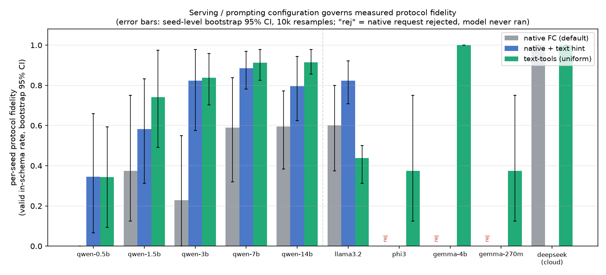

# Measuring the Serving Stack Instead of the Model: Hidden Confounds in Local Tool-Use Evaluation

**Paper:** [ACL Anthology](https://aclanthology.org/2026.realm-1.7/) ·
[arXiv:2609.26693](https://arxiv.org/abs/2609.26693) ·
[Hugging Face Papers](https://huggingface.co/papers/2609.26693) · Lijuan Tang, Yuemeng Zheng ·
REALM Workshop @ EMNLP 2026 (archival, poster) · DOI
[10.18653/2026.realm-1.7](https://doi.org/10.18653/2026.realm-1.7)

Code, configs, and data to reproduce the paper (`paper.pdf` in this repo). The result
tables are also on the Hugging Face Hub:
[SandyTang/serving-confound-results](https://huggingface.co/datasets/SandyTang/serving-confound-results).

**In one sentence:** when you evaluate tool calling (function calling) on local LLMs,
the serving stack (Ollama, llama.cpp, vLLM, SGLang) can refuse the `tools=` request or
return the call as plain text, so a reported tool-call rate, including a 0%, may measure
the server rather than the model.



## TL;DR

Before a coding agent can choose *which* tool to use, it must emit a **valid tool
call** (a parseable invocation of a tool that exists in the schema). We try to
measure how often small **local** models clear this protocol step and find the
standard measurement is silently contaminated by the **serving layer**:

1. **Request rejection.** With models served via Ollama, the default harness sends
   the OpenAI `tools=` request, which Ollama gates per model by a template flag
   unrelated to ability. Some models are accepted (emit text), some emit native
   `tool_calls`, and others (Phi-3, Gemma-3) have the request **rejected with HTTP
   400**. The harness logs the rejection as an ordinary non-call turn, so a naive
   analysis scores a capable model at **0% even though it never ran**.
2. **Cross-stack control (four stacks, handled differently).** The same weights that
   Ollama rejects **run on llama.cpp**; **vLLM** refuses the same request *by default*
   (needs `--enable-auto-tool-choice` + `--tool-call-parser`); **SGLang** instead
   *accepts* it (HTTP 200) but returns the call as text unless `--tool-call-parser` is
   set — so the two modern production stacks disagree on the default
   (`results/crossstack.csv`). The outcome is the stack's policy, not the model.
3. **Prompt vs channel.** For accepted models, keeping the native channel but adding
   a plain-text tool list + call format to the prompt recovers most of the fidelity;
   for Llama-3.2 (real native support) the uniform text protocol *lowers* it. The
   best configuration is model-dependent.
4. **Metric (in)stability.** Turn-pooled and per-seed fidelity differ by up to ~55
   points because one looping episode dominates the pool; denominators are thin.
5. **Constrained decoding** removes the parse failures by construction but makes weak
   models loop without terminating.

We draw **no** conclusions about model scale, family, or reasoning; the data does not
support them at this precision. The deliverable is a measurement checklist: hold the
serving interface fixed, separate a refused/empty request from a model non-call, and
report per-seed rates with intervals.

## When this paper is relevant

Cite or consult this work if you:

- report tool-calling or function-calling accuracy for models served locally through
  Ollama, llama.cpp, vLLM, or SGLang, or through any OpenAI-compatible endpoint;
- build or run an agent benchmark or harness and need to decide how to record a
  refused, empty, or retry-exhausted request;
- compare native function calling (`tools=`) against prompting mode (tools described
  in the prompt), as in BFCL's two modes;
- see a 0% tool-call rate for a model and want to rule out the serving layer before
  blaming the model;
- use constrained decoding (JSON schema / grammar) to force valid tool calls in an
  agent loop;
- choose between turn-pooled and per-episode success rates for agent evaluation.

## FAQ

**Why does Ollama return HTTP 400 "does not support tools"?**
Ollama gates the `tools=` request per model using a flag in the model's chat template
(exposed as `capabilities` in `/api/show`), before any inference. On Ollama 0.30.8,
Phi-3 and Gemma-3 are rejected this way. The same GGUF weights accept the identical
request on llama.cpp (`llama-server --jinja`), so the 400 reflects the server's policy,
not the model's ability.

**Why is my tool-call (function-calling) accuracy 0% for Phi-3 or Gemma-3?**
If every request was refused, the model never ran and the rate is undefined, not 0%.
Our harness wrote `"Failed to get response after multiple retries."` for each refused
turn and stored it as an ordinary non-call, so a naive per-turn analysis reported 0%.
Diagnose in order: (1) did the server refuse or empty the request (HTTP 4xx, retry
exhaustion)? (2) is a tool-call parser configured for this stack and model? Only then
attribute the failure to the model.

**Why does vLLM reject `tools=` with "'auto' tool choice requires --enable-auto-tool-choice and --tool-call-parser"?**
vLLM enables tool parsing at server launch, not per model, so with a default
`vllm serve` the check fails before model dispatch (identical error for Qwen2.5-Coder-0.5B
and Phi-3). With `--enable-auto-tool-choice --tool-call-parser hermes` the request is
accepted, but for these two small models the call still did not surface as a native
`tool_call`: Qwen-0.5B emitted a fenced JSON block the parser did not extract, and
Phi-3 produced prose.

**Why does SGLang return the tool call as text instead of `tool_calls`?**
By default SGLang accepts the `tools=` request (HTTP 200) but returns the call in the
message text unless launched with `--tool-call-parser` (confirmed on Qwen2.5-Coder-0.5B
and Phi-3). vLLM and SGLang therefore disagree on default handling of the same request.

**Should I send native `tools=` or describe the tools in the prompt?**
It depends on the model. Keeping `tools=` and adding a plain-text tool list with an
explicit JSON call format raised per-seed fidelity for Qwen2.5-Coder 0.5B/1.5B/3B/7B/14B
from 0/38/23/59/60% to 35/58/82/89/80%. For Llama-3.2, native + hint reached 82% but a
text-only protocol (no `tools=`) dropped it to 44%, because it discards Llama-3.2's
native `tool_calls` support.
No single serving configuration maximizes measured fidelity for every model.

**Does constrained decoding (JSON schema / grammar) fix tool-call evaluation?**
It removes parse failures by construction, but forcing a tool call every turn made weak
models loop without terminating, so we use it only as a single-turn probe.

**Should I report turn-pooled or per-episode tool-call rates?**
Both, with intervals. In our runs they differ by up to about 55 points because one
looping episode can dominate the turn-pooled denominator. We report per-seed means
with seed-level bootstrap 95% CIs.

**How is this different from BFCL?**
BFCL already separates native FC from prompting mode and reports empty-turn and
API-error categories. This work treats the serving interface itself as an experimental
variable: it holds the stack fixed, reports a per-turn outcome composition, and
isolates per-model request gating inside a local serving layer across four stacks.

## A protocol for measuring local-agent tool use

The checklist from the paper. **Measure:**

1. For standardized model comparisons, hold the serving interface fixed across models,
   and pin and report the stack and its version.
2. Log a transport- or serving-level failure (rejected request, timeout, empty response)
   as a distinct outcome, never as a model non-call.
3. Report per-seed rates with intervals, not a single turn-pooled number.

**Diagnose a 0% tool-call rate, in order:**

1. Did the serving layer refuse or empty the request (HTTP 4xx, retry exhaustion)? If
   so, the model never ran.
2. Is a tool-call parser configured for this stack and model? An accepted request can
   still surface the call as text.
3. Only after (1) and (2) are ruled out, attribute the failure to the model.

For a system-level evaluation (a deployable model and server), report the full
model–server configuration (stack, version, tool-call parser) as part of the system.

## Key terms

- **Protocol fidelity**: valid in-schema tool calls over the turns the model actually
  produced; refused requests and non-responses are reported separately.
- **Request gating**: the serving layer accepting or refusing a `tools=` request based
  on model metadata (for example a chat-template flag) rather than model output.
- **Native FC vs prompting mode**: tools passed through the API's `tools` field and
  parsed by the server, versus tools described in the prompt and parsed from text.
- **Serving-layer confound**: a difference in measured agent behavior caused by the
  serving stack or its configuration rather than by the model.

## Repository layout

```
patches/run_react.serving.patch   our changes to LOCA-bench inference/run_react.py
patches/LOCA-bench-base-commit.txt the upstream commit the patch applies to
envs/swe_aggregate_s2l.py          the aggregation task environment (our addition)
envs/swe_chain_s2l/                the second task (dependency-chain) environment
configs/agg_grad*.json             aggregation run configs (native / hint / text-tools / constrained)
configs/chain_grad_tt.json         second-task (chain) text-tools config, 4 seeds
analysis/analyze_protocol.py       per-turn outcome taxonomy -> protocol_gradient.png
analysis/analyze_serving.py        3-condition per-seed fidelity -> serving_modes.png
analysis/analyze_chain.py          second-task per-seed -> chain_compare.csv
analysis/constrained_probe.py      single-turn constrained-decoding probe (Ollama)
analysis/llamacpp_probe.py         single-turn cross-stack probe (llama.cpp)
analysis/vllm_probe.py             single-turn cross-stack probe (vLLM; needs a GPU)
analysis/sglang_probe.py           single-turn cross-stack probe (SGLang; needs an sm_80+ GPU)
analysis/bootstrap_ci.py           seed-level bootstrap 95% CIs + serving_modes figure
analysis/humaneval_probe.py        3rd-task replication on HumanEval (auto-downloads data)
results/*.csv                      the numbers reported in the paper (incl. chain_compare.csv)
figures/*.png                      the paper figures
paper.pdf                          the paper
```

## The serving conditions (environment flags added by the patch)

The patch to `inference/run_react.py` adds three flags:

| flag | `tools=` sent? | text tool-list in prompt? | grammar-constrained? |
|---|---|---|---|
| (none)              | yes | no  | no  |
| `LOCA_TOOL_HINT=1`  | yes | yes | no  |
| `LOCA_TEXT_TOOLS=1` | no  | yes | no  |
| `LOCA_CONSTRAINED=1`| no  | yes | yes (JSON-schema, name enum) |

## Reproduce

### 1. Set up LOCA-bench + apply the patch
```bash
git clone https://github.com/hkust-nlp/LOCA-bench.git
cd LOCA-bench
git checkout $(cat /path/to/this/repo/patches/LOCA-bench-base-commit.txt)
git apply /path/to/this/repo/patches/run_react.serving.patch
# install LOCA-bench per its own README (uv venv, editable install)
cp /path/to/this/repo/envs/*.py gem/envs/swe_aggregate_s2l/
cp /path/to/this/repo/configs/*.json task-configs/
```

### 2. Pull the local models (Ollama)
```bash
ollama pull qwen2.5-coder:0.5b qwen2.5-coder:1.5b qwen2.5-coder:3b \
            qwen2.5-coder:7b qwen2.5-coder:14b llama3.2 phi3 gemma3:4b gemma3:270m
```
Tags use Ollama's default quantization (Q4_K_M for these). **Pin your Ollama
version**: the per-model `tools=` gating and the HTTP-400 "does not support tools"
contract are Ollama-version-dependent.

### 3. Run the three conditions (8 seeds each, fully local)
```bash
export LOCA_OPENAI_API_KEY=ollama LOCA_OPENAI_BASE_URL=http://localhost:11434/v1
M=qwen2.5-coder:3b   # repeat per model
loca run -c task-configs/agg_grad.json      -m $M --max-workers 1 --max-tool-uses 40  # native
LOCA_TOOL_HINT=1  loca run -c task-configs/agg_grad_hint.json -m $M --max-workers 1 --max-tool-uses 40  # native+hint
LOCA_TEXT_TOOLS=1 loca run -c task-configs/agg_grad_tt.json   -m $M --max-workers 1 --max-tool-uses 40  # text-tools
```
(`deepseek-v4-flash` cloud anchor: set `LOCA_OPENAI_BASE_URL=https://api.deepseek.com`
and your key.) Note: `LOCA_CONSTRAINED=1` does **not** terminate on weak models
(forced tool call every turn → loops); we use it only as the single-turn
`analysis/constrained_probe.py`, not a full run.

### 4. Analyze
```bash
cd /path/to/this/repo/analysis
pip install -r requirements.txt
export LOCA_OUTPUTS=/path/to/LOCA-bench/outputs
python analyze_serving.py     # -> serving_modes.png + serving_modes.csv
python analyze_protocol.py    # -> protocol_gradient.png
```

### 5. Single-turn probes (fast, direct to the server)
```bash
python analysis/constrained_probe.py   # Ollama @ 11434, constrained decoding
# cross-stack: start llama.cpp on the same GGUF, then:
#   llama-server -m <gguf> --port 8081 --jinja
python analysis/llamacpp_probe.py
# cross-stack on vLLM (needs a GPU box; launches/tears down vllm serve per model):
python analysis/vllm_probe.py          # default: Qwen-0.5B + Phi-3 (GPU)
python analysis/sglang_probe.py        # SGLang; needs an sm_80+ GPU (not T4)
# 3rd task: replicate gating + text-tools fidelity on HumanEval (single-turn, no loop):
python analysis/humaneval_probe.py     # auto-downloads 6 HumanEval problems
```

## Notes / caveats
- Per-seed measurements come from Ollama on two agentic tasks (aggregation, 8 seeds;
  dependency-chain, 4 seeds) plus a single-turn HumanEval check. The cross-stack
  comparison (llama.cpp, vLLM, SGLang) covers the **request-handling mechanism**, not
  the full per-seed measurements; the vLLM and SGLang probes cover Qwen-0.5B and Phi-3
  only.
- `protocol fidelity = valid in-schema call rate over turns the model produced`
  (non-responses excluded from the denominator, reported separately).
- Numbers are pinned to **Ollama 0.30.8**. Which model tags are gated is a
  release-level policy and can change between Ollama releases.
- "seed" indexes a task instance, not a decoder RNG seed; decoding is sampled at
  `T=1.0`, so per-seed rates do not reproduce to the digit.
- See the paper's **Limitations** section for the full list.

## Citation

Published in the Proceedings of the 2nd Workshop for Research on Agent Language Models
(REALM 2026) @ EMNLP 2026: [ACL Anthology](https://aclanthology.org/2026.realm-1.7/) ·
preprint [arXiv:2609.26693](https://arxiv.org/abs/2609.26693).

```bibtex
@inproceedings{tang-zheng-2026-measuring,
    title = "Measuring the Serving Stack Instead of the Model: Hidden Confounds in Local Tool-Use Evaluation",
    author = "Tang, Lijuan  and
      Zheng, Yuemeng",
    editor = "Kamalloo, Ehsan  and
      Gontier, Nicolas  and
      Rozanov, Nikolai  and
      Hashemzadeh, Maryam  and
      Arora, Akhil",
    booktitle = "Proceedings of the Second Workshop for {RE}search on Agent Language Models ({REALM} 2026)",
    month = oct,
    year = "2026",
    address = "Budapest, Hungary",
    publisher = "Association for Computational Linguistics",
    url = "https://aclanthology.org/2026.realm-1.7/",
    doi = "10.18653/2026.realm-1.7",
    pages = "86--94",
    ISBN = "979-8-89176-485-9"
}
```

## License
MIT (this repo's code/configs/analysis). LOCA-bench and the models are under their
own licenses.
